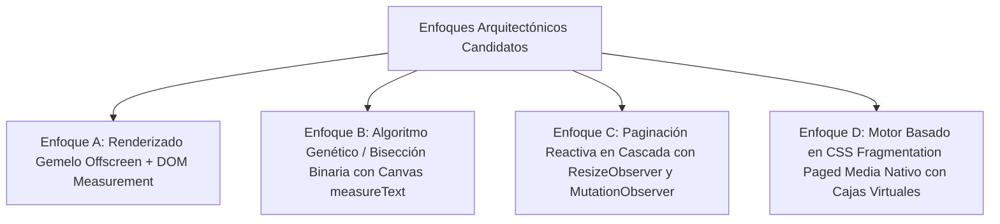

# DOCUMENTO DE SOLICITUD DE AUDITORÍA EXTERNA: EL PROBLEMA SISTÉMICO DE LOS QUIEBRES DE PÁGINA Y LA MAXIMIZACIÓN DE CONTENIDO EN RESSUME

---

## 1. INTRODUCCIÓN Y MANIFIESTO DEL PROBLEMA

### 1.1. Propósito de esta Auditoría
Este documento constituye un pliego de condiciones técnicas exhaustivo y una solicitud formal de auditoría y rediseño arquitectónico dirigida a ingenieros distinguidos, arquitectos de software frontend y especialistas en motores de renderizado web. 

El sistema **Ressume** es un editor de currículums de alta gama construido sobre React 18, Vite y Vanilla CSS. Su objetivo fundamental de producto es proporcionar una experiencia **WYSIWYG absoluta (What You See Is What You Get)** donde un usuario diseña su currículum en pantalla visualizando hojas A4 discretas e independientes (`210mm x 297mm`), con la garantía matemática de que al presionar el botón de exportación o imprimir a PDF vectorial, la salida física impresa sea un calco 1:1, píxel a píxel, de lo que observaba en el editor.

Sin embargo, el proyecto sufre un defecto crítico, persistente y reiterado en su subsistema de paginación y partición de contenido: **la incapacidad sistemática de maximizar el contenido útil en cada página A4 y el desacato crónico del margen inferior fijado por el usuario**. 

### 1.2. El Mandato de Negocio No Negociable: La Ley del Margen de Usuario
En el diseño de currículums profesionales, el espacio vertical es el recurso más escaso y valioso. Un postulante que busca condensar su trayectoria en exactamente una o dos páginas no tolera que el software desperdicie espacio vertical.

La regla dorada de producto se enuncia formalmente de la siguiente manera:
> **LA REGLA DEL MARGEN INFERIOR ESTRICTO:**
> Si el usuario configura en la interfaz un margen de página de $M$ píxeles (por ejemplo, $12\text{ px}$, $20\text{ px}$ o $24\text{ px}$), el contenido de cada página A4 **DEBE** fluir, distribuirse y particionarse de modo que se aproveche cada milímetro disponible, deteniéndose **única y estrictamente** a $M$ píxeles antes del borde inferior del contenedor físico A4.
> 
> Es formalmente inaceptable, inadmisible y considerado un defecto grave que una página termine dejando un hueco o vacío en blanco mayor a $M$ píxeles (por ejemplo, $80\text{ px}$, $150\text{ px}$ o $270\text{ px}$) si el siguiente elemento o una sub-unidad divisible del mismo (como una viñeta, un ítem de historial laboral o una línea de párrafo) tenía capacidad física de encajar en dicho espacio sin superar el margen configurado.

### 1.3. La Paradoja de los Intentos Previos de Reparación
A lo largo de múltiples ciclos de desarrollo, diferentes ingenieros y agentes autónomos de inteligencia artificial han intentado mitigar este comportamiento errático. Sin embargo, todos los intentos han caído en un patrón recurrente de **parches heurísticos superficiales**:
1. Si se detecta un hueco de $200\text{ px}$ en la Página 1, el agente altera arbitrariamente una constante tipográfica (por ejemplo, reduciendo el ancho promedio de carácter `charWidth` de $10.5$ a $9.6$ en `pageDistributor.js`).
2. La reducción hace que momentáneamente una sección entre en la Página 1, pero ante cualquier variación menor (un cambio en la escala tipográfica, un título con dos palabras largas, el uso de negrita, o la apertura de la aplicación en otra resolución de pantalla), la estimación matemática vuelve a desacoplarse del renderizado real del navegador.
3. Peor aún: cuando el motor se vuelve demasiado "optimista", ocurre el desastre inverso: un elemento desborda la página física por apenas $3\text{ px}$ en la vista impresa, provocando que el navegador genere una página en blanco adicional con una sola línea huérfana (la temida "página fantasma").
4. Aterrorizados por la página fantasma, los desarrolladores vuelven a introducir "márgenes de seguridad" (`safetyHeadroom = 40px`, `safetyHeadroom = 15px`), restaurando instantáneamente los huecos en blanco gigantescos que enfurecen al usuario.

El panel auditor debe comprender que **no se busca otro ajuste de números mágicos ni otra calibración de constantes estáticas**. Se requiere una auditoría que identifique la falla fundamental en las premisas de diseño del software y proponga una re-arquitectura determinista, matemáticamente sólida y visualmente infalible.

---

## 2. ANTECEDENTES Y REGISTRO FORENSE DE FRACASOS

Para no repetir errores que ya costaron semanas de desarrollo, el auditor debe familiarizarse con la documentación histórica del repositorio, en particular el documento de post-mortem `FRACASO_SALTOS_DE_PAGINA.md` y las invariantes de arquitectura consagradas en `AGENTS.md`.

### 2.1. El Post-Mortem de `FRACASO_SALTOS_DE_PAGINA.md`
En fases previas del proyecto, se intentó implementar un sistema de paginación híbrido en el que una sábana continua de HTML intentaba predecir dónde caería la hoja A4 mediante inyecciones dinámicas en tiempo de ejecución. 

El documento de post-mortem clasifica los siguientes fracasos críticos:

#### A. El Fracaso del "Doble Motor en Conflicto"
Se intentó ejecutar un script JavaScript antes del evento `window.print()` que medía elementos en pantalla usando `getBoundingClientRect()` y calculaba desfases para inyectar dinámicamente propiedades CSS en línea (`margin-top: 142px`, `padding-top: 80px`) sobre los nodos que parecían cruzar el límite de la página.
- **Resultado catastrófico:** Las métricas de pantalla (renderizado subpíxel rasterizado en pantalla de 96 DPI en espacio de color RGB) difieren inevitablemente del cálculo vectorial del motor de impresión del navegador (`@media print` procesando puntos tipográficos PostScript a 72 pt/pulgada bajo Gecko o Chromium).
- Los elementos que en pantalla parecían requerir $50\text{ px}$ de empuje, en el motor de impresión ya habían quebrado naturalmente dos líneas antes. Las inyecciones de `margin-top` forzadas terminaron sumándose al quiebre nativo del navegador, desplazando títulos a la mitad inferior de las hojas y dejando bloques huérfanos con márgenes artificiales desorbitados.

#### B. El Fracaso de los Selectores de Lista y `break-before: page`
En un intento desesperado de forzar quiebres, se asignó `break-before: page` a clases CSS genéricas como `.cv-block` o `.experience__content`.
- **Resultado catastrófico:** Cada experiencia laboral individual provocó un salto de página forzado. Un currículum con 6 empleos se transformó instantáneamente en un documento de 7 páginas, documentado físicamente en el repositorio en el archivo `muestra_fracaso.pdf`.

#### C. El Engaño de las Suites de Pruebas Unitarias Sintéticas
Uno de los descubrimientos más aleccionadores de la historia del proyecto fue la **total inutilidad de Vitest / JSDOM para validar la paginación real**:
- Las suites de pruebas en JSDOM reportaban **100% de tests aprobados (83 archivos de test, más de 1,180 tests en verde)**.
- Sin embargo, JSDOM no cuenta con un motor de layout ni de renderizado tipográfico. En el entorno de JSDOM:
  $$\text{element.offsetHeight} = 0$$
  $$\text{element.getBoundingClientRect()} = \{ \text{top: 0, left: 0, width: 0, height: 0} \}$$
- Todos los tests estaban alimentados con objetos "mock" y cálculos matemáticos tautológicos. El algoritmo probaba su propia lógica interna simulada contra sí mismo. Mientras los tests celebraban paridad absoluta en la terminal de Node.js, al abrir la aplicación en el navegador real (Zen Browser / Firefox Gecko / Chrome Blink), el currículum lucía roto, con secciones truncadas y enormes vacíos al pie de la página.

### 2.2. Las Invariantes Arquitectónicas de `AGENTS.md`
Como consecuencia directa del historial de fallos, se redactaron principios de observancia obligatoria en `AGENTS.md`:

1. **Invariante 15: Cajas A4 Fijas Nativas en el Editor (`Editor-Native Discrete A4 Boxes`)**
   El editor (`#area-cv`) no puede ser un contenedor de flujo vertical continuo infinito con líneas discontinuas que simulen los cortes. La interfaz de usuario debe componerse directamente de una lista de cajas cerradas `<A4PageBox pageNumber={N}>`.
   Cada `.a4-page-box` en pantalla y en papel debe medir exactamente:
   ```css
   width: 210mm;
   min-width: 210mm;
   max-width: 210mm;
   height: 297mm;
   min-height: 297mm;
   max-height: 297mm;
   overflow: hidden;
   box-sizing: border-box;
   position: relative;
   margin: 0 auto 32px auto;
   ```
2. **Invariante 16: Principio de Estructura Fija Tallada en Piedra (`Zero Dynamic Reflow on Print`)**
   El editor es la **única fuente de verdad**. La decisión de qué componente, experiencia o viñeta reside en la Página 1, Página 2 o Página $N$ la toma la aplicación en su estado React antes de cualquier intento de impresión. El motor de impresión (sea `@media print`, un iframe o un generador PDF) es estrictamente pasivo: proyecta exactamente lo que el editor determinó. Queda terminantemente prohibido que el diálogo de impresión altere el flujo o recalcule saltos.
3. **Invariante 17: Directiva de Minimalismo Radical y Reemplazo Tecnológico**
   Se autoriza formalmente al equipo o auditor a demoler, sustituir o reescribir cualquier subsistema heurístico de estimación estática si existe una solución técnica moderna, limpia, determinista y matemáticamente comprobable que resuelva el problema con menor complejidad accidental.

---

## 3. ANÁLISIS FORENSE DEL ESTADO ACTUAL DEL CÓDIGO

Para proporcionar al panel auditor todos los elementos de juicio, analizamos en detalle los módulos que gobiernan la distribución de páginas actualmente en el repositorio.

### 3.1. El Pipeline de Datos
El pipeline actual opera bajo la siguiente secuencia unidireccional:

```
[ Estado Global React (cvData) ]
              │
              ▼
[ Hook Reactivo: src/hooks/useDocumentPages.js ]
              │
              ▼
[ Motor Matemático Estático: src/utils/pageDistributor.js ]
   ├── estimateHeaderHeight()
   ├── estimateItemHeight() ── getCharsPerLine()
   └── distributeSectionListToPageBuckets()
              │
              ▼
[ Modelo Inmutable: pages = [ PageModel_1, PageModel_2, ... ] ]
              │
              ├─────────────────────────────────────────┐
              ▼                                         ▼
[ Render Editor UI: A4PageBox.jsx ]       [ Render Export PDF: staticHtmlPdfEngine.js ]
   (overflow: hidden, 210x297mm)             (@media print, break-inside: avoid)
```

### 3.2. Disección de `src/utils/pageDistributor.js`

El archivo `pageDistributor.js` pretende ser un simulador matemático offline del motor de renderizado de fuentes del navegador. Analicemos sus funciones centrales y sus vulnerabilidades intrínsecas:

#### A. Definición de Constantes Físicas
```javascript
export const A4_HEIGHT_PX = 1123; // Altura estándar a 96 DPI (297mm / 25.4 * 96)
export const DEFAULT_PAGE_PADDING = 24; // Padding por defecto en px
```

#### B. Cálculo de la Capacidad Útil
```javascript
const padding = mergedOptions.pagePadding ?? DEFAULT_PAGE_PADDING;
const pageHeight = mergedOptions.pageHeightPx ?? A4_HEIGHT_PX;
// Se eliminó safetyHeadroom para buscar margen cero:
const usefulCapacity = mergedOptions.pageCapacity ?? (pageHeight - 2 * padding);
```
Si el usuario configura `padding = 12px`:
$$\text{usefulCapacity} = 1123 - (2 \times 12) = 1099\text{ px}$$
La teoría indica que la página debería admitir contenido hasta acumular $1099\text{ px}$. Sin embargo, en la práctica el motor expulsa contenido a la Página 2 cuando el acumulador visual real apenas ronda los $800\text{ px} - 900\text{ px}$.

#### C. La Estimación Heurística de Alturas (`estimateItemHeight` y `getCharsPerLine`)
Para calcular cuántos píxeles verticales ocupará una experiencia laboral, un proyecto o una educación, `pageDistributor.js` implementa:

```javascript
export function getCharsPerLine(columnWidth, fontScale = 1, isAts = false) {
  // Ajuste reciente: se cambió baseCharWidth de 10.5 a 9.6 para modo ATS
  const baseCharWidth = isAts ? 9.6 : 10.5;
  const charWidth = baseCharWidth * fontScale;
  return Math.max(15, Math.floor(columnWidth / charWidth));
}

export function estimateItemHeight(item, isTwoCol = false, isAts = false, fontScale = 1) {
  const colWidth = getItemWidth(isTwoCol, isAts);
  const charsPerLine = getCharsPerLine(colWidth, fontScale, isAts);
  const baseLineHeight = 18 * fontScale;
  let height = 0;

  // Cálculo de título, subtítulo, fechas
  if (item.title || item.role) {
    const titleLen = (item.title || item.role || '').length;
    const titleLines = Math.max(1, Math.ceil(titleLen / charsPerLine));
    height += titleLines * (20 * fontScale);
  }
  // ... suma de institución, fechas, descripción ...
  
  // Suma de viñetas (bullets)
  if (Array.isArray(item.bullets)) {
    for (const b of item.bullets) {
      const bText = typeof b === 'string' ? b : (b?.text || '');
      const bLines = Math.max(1, Math.ceil(bText.length / charsPerLine));
      height += bLines * baseLineHeight + (4 * fontScale); // gap entre viñetas
    }
  }
  return height;
}
```

#### D. La Lógica de Decisión de Partición (`distributeSectionListToPageBuckets`)
El algoritmo recorre secuencialmente la lista de secciones y decide el destino de cada elemento aplicando tres criterios en orden:

```javascript
for (const section of sectionList) {
  const sectionTotalHeight = estimateSectionHeight(section, isTwoCol, isAts, fontScale);
  const gap = currentBucket.length > 0 ? (20 * fontScale) : 0;

  // CRITERIO 1: ¿Cabe la sección completa en el espacio restante?
  if (accumulatedHeight + gap + sectionTotalHeight <= usefulCapacity) {
    currentBucket.push(section);
    accumulatedHeight += gap + sectionTotalHeight;
    continue;
  }

  // CRITERIO 2: Prevención de Encabezado Huérfano (Orphan Header Check)
  const headerHeight = estimateHeaderHeight(section, fontScale);
  const firstItem = section.items?.[0];
  const firstItemHeight = firstItem 
    ? estimateItemHeight(firstItem, isTwoCol, isAts, fontScale)
    : 30;
  const minNeededForFirstItem = gap + headerHeight + firstItemHeight;

  if (accumulatedHeight + minNeededForFirstItem > usefulCapacity) {
    // FALLA GRAVE: Expulsa la sección ENTERA a la siguiente página
    pageBuckets.push(currentBucket);
    currentBucket = [section];
    accumulatedHeight = headerHeight + sectionTotalHeight; // Ojo: recalculo
    continue;
  }

  // CRITERIO 3: Partición Granular de Ítems y Viñetas (Split Section)
  // Divide los ítems de la sección entre el bucket actual y el siguiente...
}
```

---

## 4. LA ANATOMÍA DEL DEFECTO: ¿POR QUÉ FALLA CRÓNICAMENTE ESTE MODELO?

A continuación se exponen las cinco fallas conceptuales profundas que impiden que el agente, mediante simples retoques numéricos, consiga maximizar el contenido respetando el margen del usuario.

### 4.1. Falla Conceptual 1: El Supuesto Lineal del "Ancho de Carácter" en Tipografías Proporcionales
El algoritmo asume que el texto en la web se comporta como una máquina de escribir de paso fijo (*monospace*), donde cada carácter ocupa exactamente `charWidth` píxeles.
- En la realidad, el currículum se renderiza utilizando fuentes proporcionales modernas como **Inter**, **Roboto** o **Helvetica**.
- En la tipografía Inter a tamaño regular ($14\text{ px}$):
  - El carácter `i` mide apenas $3.8\text{ px}$ de ancho.
  - El carácter `l` mide $3.9\text{ px}$.
  - El carácter `m` mide $11.5\text{ px}$.
  - El espacio en blanco mide $4.2\text{ px}$.
  - Los glifos en minúsculas comunes (`e, a, s, t, r, n`) promedian entre $6.5\text{ px}$ y $7.5\text{ px}$.
- Al utilizar un multiplicador estático conservador ($9.6\text{ px}$ o $10.5\text{ px}$ por carácter), el algoritmo sobreestima sistemáticamente la cantidad de líneas que un párrafo ocupará.
- **Demostración de la Desviación Acumulada:**
  - En modo ATS, el ancho de columna disponible es de $746\text{ px}$.
  - Una viñeta de $180$ caracteres con redacción técnica típica (ej: *"Lideré el diseño e implementación de una arquitectura de microservicios en Go y PostgreSQL, reduciendo la latencia de respuesta en un 35% bajo picos de 10k RPS"*):
    - **Cálculo de `getCharsPerLine(746, 1, true)` con `baseCharWidth = 9.6`:**
      $$\text{charsPerLine} = \lfloor 746 / 9.6 \rfloor = 77\text{ caracteres por línea}$$
      $$\text{Líneas estimadas} = \lceil 180 / 77 \rceil = 3\text{ líneas} \implies 3 \times 18\text{ px} + 4\text{ px} = 58\text{ px}$$
    - **Renderizado Real del Navegador en el DOM:**
      Los $180$ caracteres de esa oración suman en píxeles vectoriales reales exactamente $1,180\text{ px}$ de texto continuo. Al disponerse en un contenedor con `width: 746px`, el texto quiebra exactamente en **2 líneas** ($1,180 / 746 = 1.58$).
      $$\text{Altura Real en Pantalla} = 2 \times 18\text{ px} + 4\text{ px} = 40\text{ px}$$
    - **Error de sobreestimación por viñeta:** $+18\text{ px}$ (un error del $+45\%$).
  - Si un currículum tiene $12$ viñetas distribuidas entre experiencia y proyectos:
    $$\text{Sobreestimación Total Acumulada} = 12 \times 18\text{ px} = \mathbf{216\text{ px de Altura Fantasma}}$$
- **Consecuencia Mortal:** El algoritmo consulta `accumulatedHeight` y cree que la página lleva acumulados $1,050\text{ px}$ de los $1,099\text{ px}$ permitidos. Considera que solo quedan $49\text{ px}$ libres. Pero en el DOM real del navegador, los elementos solo han ocupado $834\text{ px}$. ¡Quedaban físicamente disponibles más de $265\text{ px}$! Al llegar la siguiente sección o ítem, el algoritmo cree que no cabe y lo arroja a la Página 2, dejando un agujero en blanco gigantesco al pie de la primera hoja.

### 4.2. Falla Conceptual 2: La Barrera de Átomo Indivisible en el Criterio 2 (Orphan Header Check)
Observemos detenidamente el código del Criterio 2 en `pageDistributor.js`:
```javascript
const firstItemHeight = firstItem 
  ? estimateItemHeight(firstItem, isTwoCol, isAts, fontScale)
  : 30;
const minNeededForFirstItem = gap + headerHeight + firstItemHeight;

if (accumulatedHeight + minNeededForFirstItem > usefulCapacity) {
  // Expulsa la sección completa a la Página 2
  pageBuckets.push(currentBucket);
  currentBucket = [section];
  // ...
  continue;
}
```
Este diseño asume que el primer ítem de una sección (`firstItem`) es una **unidad atómica indivisible**.
- Imaginemos que la siguiente sección es **"EXPERIENCIA LABORAL"**.
- El primer empleo listado (`firstItem`) es un cargo de 4 años que incluye:
  - Título del cargo y empresa ($40\text{ px}$).
  - Fechas y ubicación ($20\text{ px}$).
  - 5 viñetas descriptivas detalladas ($5 \times 36\text{ px} = 180\text{ px}$).
  - Altura total de `firstItem`: **$240\text{ px}$**.
- Sumando el gap de sección ($20\text{ px}$) y el encabezado "EXPERIENCIA" ($36\text{ px}$):
  $$\text{minNeededForFirstItem} = 20 + 36 + 240 = \mathbf{296\text{ px}}$$
- Supongamos que la Página 1 tiene todavía **$250\text{ px}$ de espacio libre real**.
- ¿Qué podría entrar visualmente en esos $250\text{ px}$?
  - El encabezado "EXPERIENCIA" ($36\text{ px}$).
  - El título de la empresa y fechas ($60\text{ px}$).
  - Las primeras 3 viñetas del empleo ($3 \times 36 = 108\text{ px}$).
  - Altura consumida: $204\text{ px} \le 250\text{ px}$. ¡Encajaría de forma hermosa, armónica y maximizada! Las 2 viñetas restantes pasarían a la Página 2 como continuación natural de la trayectoria.
- **¿Qué hace el algoritmo actual?**
  Evalúa que $296\text{ px} > 250\text{ px}$. Concluye que "el primer ítem no cabe entero". Por ende, **ABORTA COMPLETAMENTE**, no permite que el Criterio 3 (partición granular) se ejecute, y **mueve toda la sección de Experiencia a la Página 2**.
- **Resultado:** La Página 1 queda con un vacío colosal de $250\text{ px}$ en blanco, incumpliendo de forma grotesca el margen de $12\text{ px}$ solicitado por el usuario.

### 4.3. Falla Conceptual 3: Ceguera del Modelo Matemático Respecto al Modelo de Caja CSS (Box Model)
El cálculo estático asume sumas aritméticas discretas ($\sum \text{alto de líneas} + \sum \text{gaps}$), ignorando por completo la complejidad del renderizado del estándar CSS:
1. **Margen Colapsado (Margin Collapsing):** En CSS en bloque, los márgenes verticales contiguos colapsan en el mayor de ellos. El algoritmo suma gaps como si fueran bloques aislados en flexbox (`height += gap`), pero si un contenedor aplica márgenes nativos, las alturas divergen.
2. **Subpixel Antialiasing y Quiebre de Línea por Cero-Coma-Píxeles:** Si el contenedor tiene `width: 746px` con `box-sizing: border-box`, pero tiene un borde de `1px` o un outline de edición, el espacio utilizable real es `744px`. Una sola palabra que exceda el ancho por $0.2\text{ px}$ provocará que el motor de texto del navegador inserte un quiebre de línea imprevisto, duplicando la altura del bloque en pantalla sin que el algoritmo estático se entere.
3. **Puntuación y Salto de Palabra (Word Wrapping / Hyphenation):** El algoritmo divide la cantidad de caracteres por una longitud fija (`length / charsPerLine`). Pero los navegadores no cortan palabras a mitad de sílaba a menos que se fuerce `word-break: break-all`. Si una palabra larga (ejemplo: *"Telecomunicaciones"*, 18 caracteres) no cabe al final de la línea física, el navegador la traslada entera a la línea siguiente, dejando la línea anterior a medio llenar. Esto altera drásticamente el número real de líneas comparado con una simple división de caracteres.

### 4.4. Falla Conceptual 4: Falta de Retroalimentación Sensorial (Feedback Loop Nulo)
En la arquitectura actual:
- El algoritmo `pageDistributor` calcula los cortes en el vacío de la memoria RAM de JavaScript.
- Retorna un array de páginas: `pages = [ { sections: [...] }, { sections: [...] } ]`.
- React toma ese array y monta los componentes en el DOM dentro de `<A4PageBox pageNumber={1}>` y `<A4PageBox pageNumber={2}>`.
- **Los elementos ya están en el DOM vivo del navegador, con sus tipografías renderizadas, sus estilos computados y sus rectángulos geométricos reales calculados por la tarjeta gráfica y el motor Blink/Gecko.**
- **Y SIN EMBARGO, EL SISTEMA NO VUELVE A MEDIRLOS NUNCA.**
- El editor no verifica si el último elemento de la Página 1 quedó a $12\text{ px}$ del fondo o si quedó a $280\text{ px}$. Tampoco verifica si en la Página 2 el primer elemento podría haber cabido en el espacio sobrante. El sistema es "sordo y ciego" a su propia materialización física en el DOM.

### 4.5. Falla Conceptual 5: El Conflicto con la Invariante 16 y el Miedo a `@media print`
¿Por qué se llegó a este esquema estático ciego?
Porque en el pasado, cuando se intentó usar CSS nativo de impresión (`break-inside: auto`), el navegador en `@media print` partía textos por la mitad de una letra o generaba páginas fantasmas. La reacción del equipo fue crear la **Invariante 16**: *"La estructura de páginas queda tallada en piedra en el Editor; el motor de impresión tiene prohibido hacer reflow dinámico"*.

La Invariante 16 es una regla de producto excelente y necesaria para garantizar WYSIWYG. **El error no radica en la Invariante 16. El error radica en creer que para tallar la estructura en piedra en el editor, el editor debía usar un oráculo matemático ciego en lugar de medir su propio DOM de forma inteligente.**

---

## 5. REQUISITOS NO NEGOCIABLES PARA LA SOLUCIÓN DEFINITIVA

Cualquier arquitectura, propuesta técnica o refactorización que surja de esta auditoría debe satisfacer **sin excepciones** los siguientes requerimientos formales:

```
┌─────────────────────────────────────────────────────────────────────────────┐
│                       MATRIZ DE REQUISITOS OBLIGATORIOS                     │
├────┬─────────────────────────────┬──────────────────────────────────────────┤
│ ID │ REQUISITO                   │ DESCRIPCIÓN TÉCNICA                      │
├────┼─────────────────────────────┼──────────────────────────────────────────┤
│ R1 │ Maximización Rigurosa del   │ Si el espacio vertical remanente en la   │
│    │ Espacio (Zero Slack)        │ Página N es >= que la altura mínima de   │
│    │                             │ la siguiente unidad divisible, dicha     │
│    │                             │ unidad DEBE posicionarse en la Página N. │
├────┼─────────────────────────────┼──────────────────────────────────────────┤
│ R2 │ Convergencia al Margen del  │ Con un margen de usuario M, el espacio   │
│    │ Usuario (Tol: ±2px)         │ entre el fondo del último elemento y el  │
│    │                             │ límite de la hoja A4 debe converger a M  │
│    │                             │ siempre que haya contenido desbordado.   │
├────┼─────────────────────────────┼──────────────────────────────────────────┤
│ R3 │ Partición Sub-Ítem Real     │ Un empleo o proyecto con múltiples      │
│    │ (Granular Bullet Splitting) │ viñetas DEBE poder quebrar sus viñetas   │
│    │                             │ entre la Página N y N+1 si el encabezado │
│    │                             │ y la primera viñeta caben en la Pág N.   │
├────┼─────────────────────────────┼──────────────────────────────────────────┤
│ R4 │ Paridad WYSIWYG Absoluta    │ Lo que el usuario ve en sus cajas A4 del │
│    │ (Pantalla vs. PDF Vectorial)│ editor debe coincidir 1:1 con la salida  │
│    │                             │ generada por staticHtmlPdfEngine.        │
├────┼─────────────────────────────┼──────────────────────────────────────────┤
│ R5 │ Rendimiento Interactivo     │ La repartición no puede degradar el hilo │
│    │ (< 16ms en tipeo continuo)  │ principal. Debe admitir debounce/raf o   │
│    │                             │ cálculo desacoplado sin provocar jank.   │
├────┼─────────────────────────────┼──────────────────────────────────────────┤
│ R6 │ Soporte Bidireccional de    │ La solución debe gobernar idénticamente  │
│    │ Modos (ATS 1-Col y 2-Col)   │ el modo ATS (ancho completo) y el modo   │
│    │                             │ dos columnas (Main + Sidebar).           │
└────┴─────────────────────────────┴──────────────────────────────────────────┘
```

---

## 6. MODELOS ARQUITECTÓNICOS EN DISPUTA: ANÁLISIS COMPARATIVO

Se solicita al panel auditor que evalúe rigurosamente los siguientes cuatro enfoques arquitectónicos candidatos para reemplazar o refactorizar el motor actual:



### 6.1. Enfoque A: Doble Pase con Contenedor de Medición Invisible (Offscreen Real DOM Measuring)
- **Concepto:** 
  Antes de comprometer las secciones a las páginas visibles, el documento se proyecta en un contenedor oculto fuera de pantalla (`<div id="offscreen-measure-sandbox" style="position: absolute; left: -9999px; width: 210mm; ...">`) que replica exactamente la tipografía, estilos, escala y anchos de columna reales.
- **Mecanismo:**
  1. Se montan las secciones secuencialmente o completas en el DOM oculto.
  2. Mediante llamadas directas a `element.getBoundingClientRect()` o `element.offsetHeight`, se obtienen las dimensiones físicas reales calculadas por el motor del navegador (con antialiasing, kerning, word-wrapping y colapso de márgenes exactos).
  3. Se inspecciona la altura de cada encabezado, cada bloque y cada elemento `<li>` individual.
  4. Con los valores métricos reales en mano (precisión de centésimas de píxel), se llena el `PageModel[0]` hasta agotar estrictamente los $\text{Capacidad} = 1123 - (2 \times \text{Margen})$.
  5. En cuanto un elemento excede el límite, se traslada al `PageModel[1]`.
- **Ventajas:**
  - Cero discrepancia matemática: Se mide exactamente lo que el navegador renderiza.
  - Elimina para siempre las variables mágicas (`baseCharWidth`, multiplicadores lineales inventados).
  - Admite viñetas con estilos tipográficos mixtos (negritas, enlaces, cursivas) sin descalibrar el cálculo.
- **Desafíos que el auditor debe responder:**
  - ¿Cómo mitigar el coste de rendimiento ("layout thrashing" o reflujo forzado del navegador) durante la escritura en vivo del usuario en un campo de texto?
  - ¿Cómo evitar desfases si las fuentes web tardan unos milisegundos en cargar (`document.fonts.ready`)?

### 6.2. Enfoque B: Medición Vectorial de Texto con la API de Canvas 2D (`measureText`)
- **Concepto:**
  Reemplazar las divisiones ingenuas de `charsPerLine` por una utilidad de medición tipográfica precisa basada en un contexto de Canvas 2D en memoria (`HTMLCanvasElement.getContext('2d')`).
- **Mecanismo:**
  ```javascript
  const ctx = canvas.getContext('2d');
  ctx.font = '14px Inter, sans-serif';
  const textWidth = ctx.measureText(textString).width;
  ```
  Permite simular el algoritmo de quiebre de palabras (*line-breaking algorithm*) del navegador de forma puramente síncrona en memoria, sin tocar el DOM.
- **Ventajas:**
  - Extremadamente rápido: Miles de cálculos en menos de $1\text{ ms}$ sin layout thrashing.
  - Resuelve la disparidad de anchos proporcionales de caracteres.
- **Desafíos que el auditor debe responder:**
  - No mide automáticamente los márgenes de contenedor, los bordes, los paddings de lista ni los espaciados inter-bloque calculados por CSS flexbox. ¿Es suficiente para garantizar el margen de $12\text{ px}$ exacto al fondo?

### 6.3. Enfoque C: Partición Reactiva en el Editor mediante Observer de Desborde (Live DOM Page Splitting)
- **Concepto:**
  El editor renderiza la Página 1 con todas las secciones que cabían tentativamente. Cada `<A4PageBox>` posee un observador de desbordamiento.
- **Mecanismo:**
  1. Si el contenedor `.a4-page-box` (que tiene altura fija de `1123px` y `overflow: hidden`) detecta que su propiedad `scrollHeight > clientHeight`, significa que hay desborde físico.
  2. Un hook de reconciliación identifica cuál fue el último nodo visible que tocó el margen prohibido de $12\text{ px}$.
  3. Desplaza ese nodo y los subsiguientes al estado de la Página 2.
  4. Si por el contrario la Página 1 detecta un espacio en blanco inferior mayor a la altura del primer elemento de la Página 2, solicita una "absorción" (*pull-back*), trayendo el ítem hacia arriba.
- **Ventajas:**
  - Totalmente adaptativo en tiempo real.
  - Opera sobre el árbol de componentes React montado.
- **Desafíos que el auditor debe responder:**
  - ¿Cómo prevenir bucles infinitos de rebote (*oscilaciones de re-renderizado*) donde la Página 1 empuja un ítem a la Página 2 y la Página 2 inmediatamente intenta devolverlo?

### 6.4. Enfoque D: Arquitectura Híbrida de Fragmentación CSS Nativa con Espejo Pasivo
- **Concepto:**
  Deconstruir la noción de que React deba particionar arrays de datos en páginas artificiales. Permitir que el documento sea un flujo semántico único y que las hojas A4 se generen mediante `break-inside: avoid` y `break-before: auto`, mientras que el editor proyecta ese flujo a través de un layout multicontenedor CSS moderno (como CSS Multi-column o CSS Regions polyfills).
- **Desafíos que el auditor debe responder:**
  - ¿Viola este enfoque la Invariante 15 y 16 de `AGENTS.md`? ¿Cómo se mantiene la capacidad del usuario de interactuar, arrastrar y soltar elementos (`@dnd-kit`) entre dos páginas físicas discretas en la pantalla de edición?

---

## 7. CUESTIONARIO EXHAUSTIVO PARA EL PANEL AUDITOR (DELIVERABLES)

Se solicita al auditor externo responder detalladamente a los siguientes 10 puntos clave en su dictamen técnico:

### Pregunta 1: Causa Raíz de la Falla en Modo ATS
En modo ATS (columna única de $746\text{ px}$ de ancho), la sección de "HABILIDADES TÉCNICAS" o la última experiencia laboral salta completa a la Página 2 dejando un espacio en blanco de hasta $274\text{ px}$ en la Página 1. Demuestre matemáticamente por qué el Criterio 2 (Orphan Header Check) en `pageDistributor.js` produce este comportamiento patológico y presente la refactorización algorítmica exacta para que la sección no sea expulsada en bloque cuando sus ítems o viñetas individuales podrían comenzar en la Página 1.

### Pregunta 2: Determinismo del Margen Inferior de Usuario
Si el usuario fija el margen en $12\text{ px}$, $20\text{ px}$ o $24\text{ px}$ a través del slider de la interfaz:
¿Cuál es la fórmula o arquitectura exacta que debe gobernar la detención del contenido para garantizar que el último elemento termine a no más de $M \pm 2\text{ px}$ del borde físico inferior de la hoja A4, erradicando los "colchones de seguridad" arbitrarios?

### Pregunta 3: Partición Granular a Nivel de Viñeta (Bullet-Level Splitting)
Actualmente, si una experiencia laboral posee 6 viñetas y no cabe completa en la Página 1, el Criterio 2 a menudo la arroja entera a la Página 2 porque evalúa `firstItemHeight` como un bloque atómico.
Detalle la estructura de datos y el algoritmo para descomponer un ítem (`experience`, `projects`, `education`) en sub-unidades divisibles en el estado de React, permitiendo que el encabezado del puesto y las primeras $K$ viñetas se rendericen al pie de la Página 1 y las viñetas restantes comiencen al tope de la Página 2, preservando la continuidad visual y semántica.

### Pregunta 4: Diagnóstico y Validación de la Medición Offscreen (Real DOM vs. Canvas 2D)
Compare técnicamente la viabilidad de implementar una pasada de medición en DOM real invisible (*offscreen measurement DOM*) versus la medición por Canvas 2D (`measureText`). ¿Cuál de las dos garantiza 100% de fidelidad con las tipografías variables del navegador y los estilos CSS aplicados, sin inducir cuellos de botella de rendimiento en la interfaz React? Provea un prototipo o pseudocódigo funcional del mecanismo propuesto.

### Pregunta 5: Resolución de la Paridad Editor vs. Exportador PDF (`staticHtmlPdfEngine.js`)
El exportador `staticHtmlPdfEngine.js` crea un iframe aislado, inyecta los estilos de `print.css` y clona los nodos de las páginas para generar el diálogo de impresión del navegador.
¿Qué reglas CSS específicas de `@media print` y `@page` deben garantizar que el navegador respete de forma determinista y pasiva la misma partición exacta calculada en pantalla, sin insertar saltos de página espontáneos ni quebrar elementos con `break-inside: avoid`?

### Pregunta 6: Mitigación del Riesgo de Páginas Fantasma (Orphan Overflow)
Si se elimina completamente el margen de seguridad (`safetyHeadroom = 0`) para aprovechar hasta el último píxel del margen del usuario, ¿cómo se previene de forma matemáticamente infalible que una variación de renderizado subpíxel de $0.5\text{ px}$ en el motor de impresión provoque que el último elemento desborde la hoja A4 y genere una página vacía adicional en el PDF?

### Pregunta 7: Estrategia de Pruebas Automatizadas Verificables (Más allá de JSDOM)
Dado que JSDOM no calcula layouts ni alturas reales, ¿qué arquitectura de pruebas automatizadas (Playwright con renderizado Chromium real, visual regression testing, captura de geometría de elementos en headless browser) debe implementar el proyecto para certificar la paridad y la maximización de página en CI/CD antes de enviar cambios a producción?

### Pregunta 8: Tratamiento de Elementos Monolíticos No Divisibles
Existen secciones como el extracto profesional (`about`), el encabezado de perfil (`profile_header`) o imágenes de fotografía (`photo`) que no contienen viñetas y consisten en un solo bloque o párrafo largo. Si un párrafo de `about` de 12 líneas no cabe completo en los $80\text{ px}$ restantes de la Página 1:
¿Debe la arquitectura soportar la fragmentación de párrafos de texto plano entre dos páginas? Si la respuesta es afirmativa, ¿cómo se gestiona la edición de texto (`contentEditable` o `textarea`) de un párrafo que cruza físicamente dos contenedores `<A4PageBox>` distintos? Si la respuesta es negativa, ¿cómo se comunica visualmente al usuario que dicho bloque es indivisible?

### Pregunta 9: Modo Dos Columnas (Classic / Modern Layout)
En el modo de 2 columnas, la columna principal (Main) y la columna lateral (Sidebar) tienen alturas independientes pero deben compartir el mismo límite inferior de la página física A4.
¿Cómo debe el algoritmo de partición coordinar los cortes de ambas columnas simultáneamente para que ninguna de las dos supere el margen inferior fijado por el usuario, sin desfasar la altura del fondo de la página ni romper la continuidad de la barra lateral en la Página 2?

### Pregunta 10: Plan de Migración y Sustitución de Código
Presente un plan paso a paso para reemplazar la lógica deficiente en `src/utils/pageDistributor.js` y `src/hooks/useDocumentPages.js`. Indique qué archivos deben ser refactorizados, cuáles deben ser eliminados y qué contratos de interfaz pública deben mantenerse para no romper las suites de pruebas existentes ni la persistencia de datos del usuario (`cvData`).

---

## 8. ESPECIFICACIÓN DEL FORMATO DE RESPUESTA ESPERADO

El panel auditor deberá presentar su dictamen estructurado en un documento técnico de respuesta que contenga:
1. **Dictamen Diagnóstico:** Validación o refutación de las 5 fallas conceptuales expuestas en la Sección 4.
2. **Especificación Matemática y Algorítmica:** Fórmulas precisas, pseudo-código del nuevo motor de distribución y estructuras de datos TypeScript/JavaScript.
3. **Código de Referencia Implementable:** Implementación completa y lista para producción de los módulos reemplazados (`pageDistributor.js` v3 / `useDocumentPages.js` refactorizado).
4. **Reglas CSS de Impresión Garantizadas:** Bloque de estilos CSS para `print.css` y `A4PageBox.jsx` que elimine cualquier discrepancia entre pantalla y papel.
5. **Estrategia de Verificación Empírica:** Script de verificación automatizada basado en Playwright para validar en navegadores reales que el margen inferior real nunca excede el margen fijado por el usuario en más de $2\text{ px}$.

---

*Este documento ha sido generado formalmente para convocar una resolución arquitectónica definitiva que ponga fin a las regresiones cíclicas de paginación en Ressume y consagre la excelencia de ingeniería del producto.*
