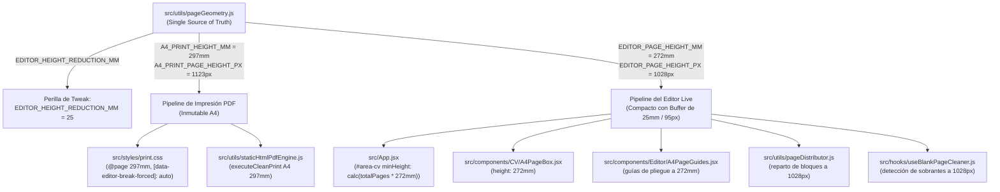

# Geometría Desacoplada: Editor Live vs. Impresión PDF (A4)
## Guía Arquitectónica y Manual de Tweaks a Bajo Nivel

---

## 1. Contexto y Justificación del Desacoplamiento

### El Problema Histórico de Desborde (Spillover)
En aplicaciones de edición de documentos basadas en navegador que pretenden exportar a PDF (A4 estándar de 210mm x 297mm):
- Los motores de renderizado de pantalla (Chromium, Gecko / Zen Browser) rasterizan fuentes tipográficas, calculan alturas de línea subpíxel y ejecutan el wrapping de texto de forma ligeramente distinta a sus motores vectoriales de impresión (`@media print` / Cairo / Skia).
- Si el contenedor del editor en vivo tiene exactamente la misma altura física (297mm / 1123px a 96 DPI) que la hoja impresa, cualquier elemento (como la última viñeta o título de sección) que quede a pocos píxeles del borde inferior en pantalla **inevitablemente se desborda** al imprimir, generando una página adicional en blanco o con una sola línea huérfana.

### La Solución Drástica: Presupuesto de Seguridad Vertical (Vertical Safety Budget)
Para resolver esto de raíz y de forma 100% determinista:
1. **El Editor en Vivo se achica verticalmente**: Su contenedor y cajas de página (`#area-cv`, `.a4-page-box`) disponen de una altura reducida calibrada a **272mm** (~1028px a 96 DPI, reducción de 25mm).
2. **El Motor de Impresión PDF se mantiene estrictamente en A4**: El CSS `@page`, la regla `@media print .a4-page-box` y el renderizado en iframe continúan gobernando estrictamente la altura física estándar de **297mm** (1123px).
3. **Garantía Matemática**: Todo contenido que el usuario vea que cabe dentro de una página en el editor, está garantizado matemáticamente que **jamás se desbordará** en el PDF impreso, ya que la hoja física A4 tiene **25mm (~95px)** de holgura de seguridad.
4. **Protección Anti-Cascada (Zero Orphan Pages)**: Los quiebres calculados por el editor (`data-editor-break-forced="true"`) tienen `break-before: auto !important` en print. Si un elemento previo desborda, no se fuerza una segunda partición artificial; los elementos continúan orgánicamente en la página siguiente sin generar hojas huérfanas intermedias.

---

## 2. Mapa Arquitectónico del Sistema

Toda la geometría se encuentra centralizada y desacoplada en:
👉 [`src/utils/pageGeometry.js`](../src/utils/pageGeometry.js)



---

## 3. Manual de Tweaks a Bajo Nivel (Cómo Ajustar)

### El Único Punto de Modificación
Para modificar la altura vertical del editor en vivo o calibrar el colchón de seguridad, **no necesitas tocar componentes ni CSS**. Solo edita la constante `EDITOR_HEIGHT_REDUCTION_MM` en [`src/utils/pageGeometry.js`](../src/utils/pageGeometry.js#L70):

```javascript
// src/utils/pageGeometry.js

// ---------------------------------------------------------------------------
// 2. LIVE EDITOR VERTICAL TUNING KNOB (Low-Level Configurable)
// ---------------------------------------------------------------------------
/**
 * Reducción de altura en milímetros para el contenedor del Editor en Vivo.
 * Modifica este único valor para calibrar la capacidad vertical del editor.
 */
export const EDITOR_HEIGHT_REDUCTION_MM = 25; // <-- ¡MODIFICA ESTE VALOR!
```

### Tabla de Configuraciones Recomendadas

| Valor de `EDITOR_HEIGHT_REDUCTION_MM` | Altura Editor (mm) | Altura Editor (px) | Buffer de Seguridad (px) | Comportamiento y Caso de Uso |
| :--- | :--- | :--- | :--- | :--- |
| **`0`** | 297 mm | 1123 px | 0 px | **Paridad matemática 1:1 estricta**. Sin margen de seguridad. Riesgo de desborde si el usuario coloca texto al límite. |
| **`15`** | 282 mm | 1066 px | 57 px | **Margen moderado (~5.0%)**. Absorbe diferencias estándar de fuentes. |
| **`25`** *(Default Actual)* | **272 mm** | **1028 px** | **95 px** | **Margen robusto anti-desborde (~8.4%)**. Absorbe diferencias de renderizado tipográfico, títulos con wrapping y viñetas densas, garantizando que todo lo que entra en el editor entra holgadamente en el PDF físico sin generar páginas intermedias. |
| **`30`** | 267 mm | 1009 px | 114 px | **Margen ultra-seguro (~10.1%)**. Para documentos con encabezados muy densos o fuentes con line-heights extendidos. |

---

## 4. Propagación Automática de Tokens y Variables CSS

Cuando modificas `EDITOR_HEIGHT_REDUCTION_MM`, el sistema recalcula automáticamente:

1. **Constantes JavaScript**:
   - `EDITOR_PAGE_HEIGHT_MM = 297 - EDITOR_HEIGHT_REDUCTION_MM`
   - `EDITOR_PAGE_HEIGHT_CSS = '272mm'`
   - `EDITOR_PAGE_HEIGHT_PX = Math.round((272 * 96) / 25.4) = 1028`
   - `EDITOR_EXACT_HEIGHT_PX = 1028.09448...`

2. **Especificación Canónica de Objeto**:
   - `getEditorPageDimensions()` y `EDITOR_PAGE_SIZE` exponen toda la geometría lista para hooks y utilidades.
   - `getPrintPageDimensions()` y `PRINT_PAGE_SIZE` (aliado con `A4_PAGE_SIZE`) conservan 297mm / 1123px intactos.

3. **Variables CSS en `:root` y en el DOM**:
   - `--editor-page-height`: `272mm`
   - `--editor-page-height-px`: `1028px`
   - `--editor-height-reduction-mm`: `25mm`
   - `--a4-page-height`: `297mm` (estricto para print)
   - `--a4-page-height-px`: `1123px` (estricto para print)

4. **Regla de Medición en Vivo (`getRulerHeightPx`)**:
   - `getRulerHeightPx(container, true)`: Mide o calcula para el editor (`1028px`).
   - `getRulerHeightPx(container, false)`: Mide o calcula para impresión física (`1123px`).

---

## 5. Invariantes de Impresión PDF Preservadas

De acuerdo con las Reglas 5, 15, 16 y 17 de [`AGENTS.md`](../AGENTS.md):
- **Cero Mutaciones Heurísticas en Impresión**: El motor de impresión pasiva ([`staticHtmlPdfEngine.js`](../src/utils/staticHtmlPdfEngine.js)) no recalcula posiciones ni inserta saltos ad-hoc.
- **`@page` Portrait Inmutable**: La hoja de salida sigue siendo una hoja física A4 estándar (210mm x 297mm) sin márgenes forzados de navegador.
- **WYSIWYG Fidedigno**: Todo bloque visible en la página 1 del editor se proyecta limpiamente en la página 1 de la hoja A4 impresa con su padding y estilos intactos.

---

## 6. Verificación de Pruebas

Para validar los cambios en la suite de pruebas:
```bash
# Ejecutar la prueba específica del presupuesto de seguridad
npx vitest run src/tests/editorSafetyHeightBudget.test.jsx

# Ejecutar las pruebas de las cajas fijas A4
npx vitest run src/tests/a4PageBox.test.jsx

# Ejecutar la suite completa
npx vitest run
```
